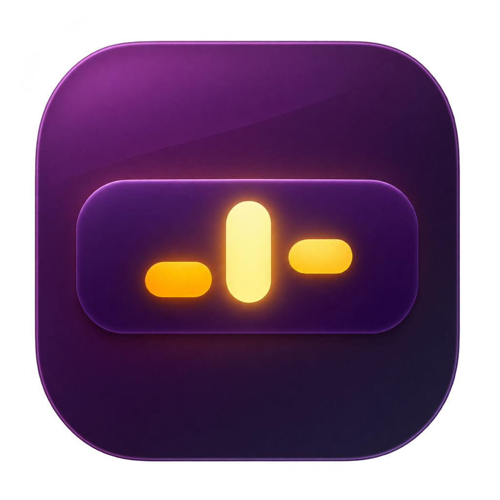

# Lid Glow



Set the brightness of the illuminated logo on your MacBook Pro independently of the screen brightness. Requires a **MacBook Pro with PROLED XDR Display** and **macOS 27.2 or later**.

## Download

1. Download **Lid-Glow-1.0.zip** from the [latest release](https://github.com/samhithpadala/lid-glow/releases/latest).
2. Unzip it, move **Lid Glow.app** to Applications, and open it.
3. Click **Use Manual** or move the slider. Click **Use Automatic** or quit to restore the default lighting.

The download is ad hoc signed and has no Apple notarization. If macOS blocks the first launch, see [Apple’s instructions for opening an app from an unidentified developer](https://support.apple.com/en-us/102445).

macOS still applies its lighting and power limits to the logo. Lid Glow uses undocumented macOS interfaces, so future macOS versions may change compatibility.

## Build from source

On an Apple silicon Mac with the Xcode Command Line Tools installed, run:

```sh
make
open "build/Lid Glow.app"
```

Run `make zip` to package the app.

The logo fade implementation draws on [LogoLight’s CoreBrightness research](https://github.com/Ark0N/LogoLight/blob/main/docs/corebrightnessd.md).

[MIT license](LICENSE)
